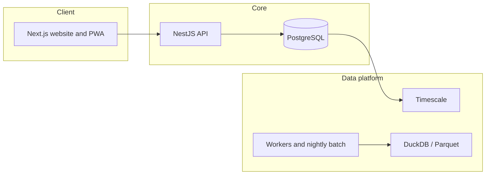

# Caddie

**Pocket caddie and improvement app for competitive amateur golfers in Belgium and the Netherlands.**

Caddie sits beside BEgolf and GOLF.NL. Official handicap and federation scoring stay there. Before the round you get structured skill prep. On the course you get club advice from your bag. Afterwards you see where strokes were lost: an SG-style breakdown against your handicap band.

> **Live demo:** not yet. Hosting is in progress (own hostname, same Railway project as GymFreak).  
> **This repo is documentation only.** Application source stays private.

Built by [Lennaert De Schepper](https://www.linkedin.com/in/lennaert-de-schepper-b40649334) — Applied Informatics, **AI & Data Engineer**, HOGENT.

Sister project (training / sleep / evidence): [GymFreak_Public](https://github.com/Lennaertds/GymFreak_Public).

---

## Where it stands

The product runs locally as one website: desktop, and the same site as a PWA on an iPhone. Prep, a round (quick scorecard or caddie card), the review, your own stats, clubs and bag, and the account are in the app. Wind, pin and a full 18 are in the caddie card. Pilot course: Rinkven.

Surfaces that are not part of that loop (feed, messages, billing) say **Under construction**.

### Now

| Piece | What it is |
|-------|------------|
| Skill prep | Range ladder, short game and putting, tied to the round |
| On the course | Scorecard, or a caddie card: distance, club from your bag, pin, wind |
| Strokes gained | Arithmetic on the round, in the worker and on the shot trace. Compared with your handicap band |
| Trends | Time-series snapshots over rounds |
| Cohorts | Nightly batch: handicap-band and club aggregates on Parquet. The published fixture is demo data until real rounds land in the export |
| Carry | Average metres per club from real on-course segments, with a lock |
| Language | A local model writes the Dutch caddie line from numbers that are already computed. A fixed template supplies the line when the model is unavailable. The numbers stay the source |
| Swing | Beta screen for a short face-on clip. Pose landmarks are used when that model is on the server. Without it the screen stays empty |

### In progress

| Track | Status |
|-------|--------|
| A round you can trust | **In progress** |
| Always-on demo | **In progress** |
| Deep learning — swing clips | **In progress** |
| Carry model on real shots | **In progress** |
| Similar shots | **In progress** |

**A round you can trust.** The screen shows the same club, metres, wind, pin, strokes gained and prep steps the engines already compute. Phone and desktop on that loop, including Dutch and French copy. A new account can play immediately and stays private until it is approved.

**Always-on demo.** Own hostname on the existing Railway project. The public URL follows a round that already holds up locally.

**Deep learning — swing clips.** Practice clips you record yourself: one camera, one angle, one club. Pose landmarks on the server, then a small network on that pose sequence (1D-CNN or LSTM), exported for serving, next to a logistic-regression baseline on the same joints. The network is the one that ships when it beats the baseline. Direction (left, straight, right) is a label from the player. The screen shows the three moments in the swing, that direction, and the sample size. Ball speed, a fault name and injury advice stay off this track.

**Carry model on real shots.** Club average, plus lie and handicap band, split by round, scored against the club average. The app keeps the club average unless that model beats it.

**Similar shots.** Nearest neighbour on real shot features. A learned vector waits until there are enough rounds to justify it.

---

## Stack

| Layer | Choice | Job | Status |
|-------|--------|-----|--------|
| Web | Next.js, React, TypeScript | Landing, the round, stats, legal. One site, desktop and iPhone PWA | In the product |
| API | NestJS, TypeScript | Auth, rounds, prep, bag. Only writer of user scores | In the product |
| Analytics | FastAPI, Python | Heavier strokes-gained and batch. Internal | In the product |
| OLTP | PostgreSQL | Users and rounds | In the product |
| Time-series | TimescaleDB (same Postgres) | Trends over rounds | In the product |
| OLAP | DuckDB on Parquet | Cohort and club aggregates | In the product |
| Jobs | Redis + BullMQ | Post-round analysis off the HTTP path | In the product |
| Batch | Airflow | Nightly OLAP pipeline | In the product |
| Objects | MinIO / S3-compatible | Pipeline artifacts and swing clips | In the product |
| Quality | Great Expectations | Seed and pipeline checks | In the product |
| Language | Ollama | Dutch line on top of computed numbers | In the product |
| Observability | Prometheus + Grafana | Pipeline and API | In the product |
| Swing model | MediaPipe pose, PyTorch, ONNX | Clip network beside a regression baseline | **In progress** |
| Carry model | Tabular model, split by round | Lie and band on top of the club average | **In progress** |
| Similar shots | Feature neighbour, learned vector later | Retrieval over real shots | **In progress** |
| Hosting | Railway (same project as GymFreak, own hostname) | Always-on demo | **In progress** |

---

## What this repo is not

- The application source.
- Credentials, env files, schemas, or API maps.
- A fork-me starter kit.

All rights reserved. See [LICENSE](./LICENSE).
