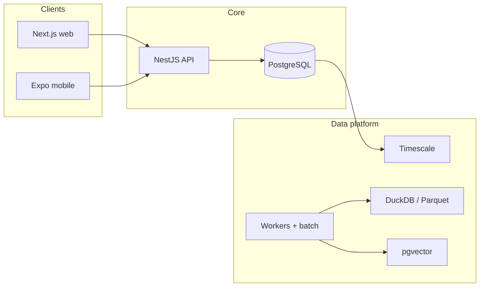

# Caddie

**Pocket-caddie + improvement app for competitive amateur golfers in Belgium.**

Caddie sits *beside* BEgolf — it does not replace official handicap or federation scoring. Before the round you get structured skill prep. On the course you get club advice from *your* bag. Afterwards you see where strokes were lost (SG-style analysis vs your handicap band, not vs tour pros).

> **Live demo:** coming soon (always-on).  
> **This repo is documentation only.** Application source stays private.

Built by [Lennaert De Schepper](https://www.linkedin.com/in/lennaert-de-schepper-b40649334) — Applied Informatics, **AI & Data Engineer**, HOGENT.

Sister project (training / sleep / evidence): [GymFreak_Public](https://github.com/Lennaertds/GymFreak_Public).

---

## What a recruiter should take away

This is not a Chart.js landing page. Caddie is a **polyglot data product**: an OLTP API writes rounds; analytics, time-series, OLAP and (optional) vectors sit beside it; the web app is the recruiter-facing demo.

---

## Stack (high level)

| Layer | Choice | Job |
|-------|--------|-----|
| Web demo | Next.js 15, React, TypeScript | Public site, stats, legal |
| Mobile | React Native (Expo), TypeScript | On-course + prep |
| Public API | NestJS, TypeScript | Auth, rounds, prep, entitlements — **only writer** of user data |
| Analytics | FastAPI, Python | Heavier SG / batch — internal, not a public API |
| OLTP | PostgreSQL | Source of truth for users and rounds |
| Time-series | TimescaleDB (same Postgres) | Trends over rounds |
| OLAP | DuckDB on Parquet | Cohort / club aggregates |
| Vectors | pgvector (same Postgres) | Similar-shot / retrieval experiments |
| Jobs | Redis + BullMQ | Post-round analysis off the HTTP path |
| Batch | Airflow (local showcase) | Nightly OLAP-style pipeline |
| Objects | MinIO / S3-compatible | Media and pipeline artifacts |
| Quality | Great Expectations | Seed / pipeline checks |
| Observability | Prometheus + Grafana (+ Sentry when configured) | Pipeline + API |
| Hosting | Railway (same project as GymFreak, **own hostname**) | Always-on demo, one bill, two brand domains |

Not every box is “on” in production on day one. The **list** is the target architecture; production ships what the LinkedIn-cut needs, without a logo wall.

---

## Product in one pass

1. **Prep** — skill work on the range (not generic stretching as the default).
2. **Play** — quick scorecard or caddie mode (distance, club from your bag).
3. **Understand** — where strokes went, trends, bag gaps.

Unfinished surfaces on the live site are marked **Under construction** instead of dead links.

---

## What this repo is not

- Not the application source.
- Not credentials, env files, schemas, or API maps.
- Not a fork-me starter kit.

All rights reserved. See [LICENSE](./LICENSE).
